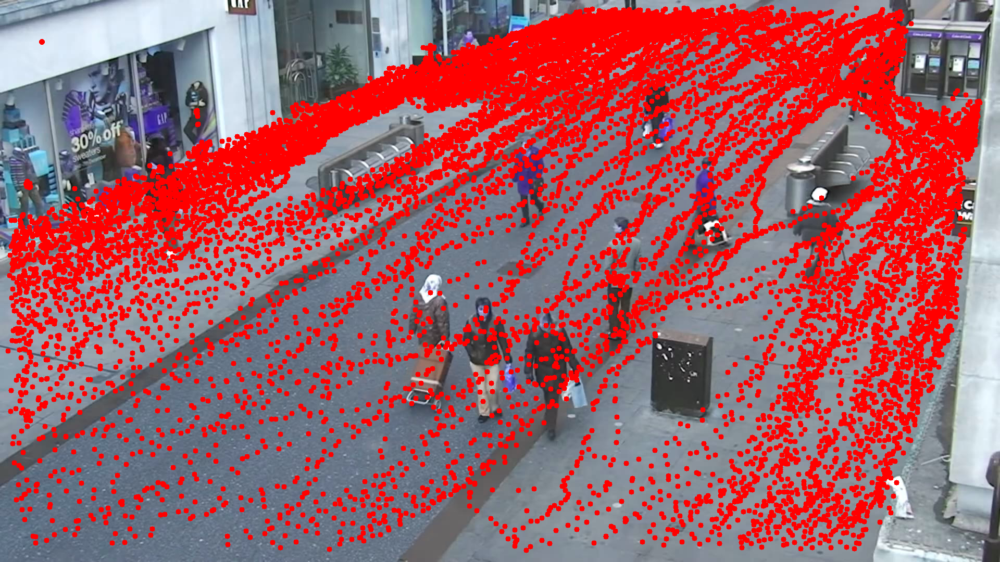
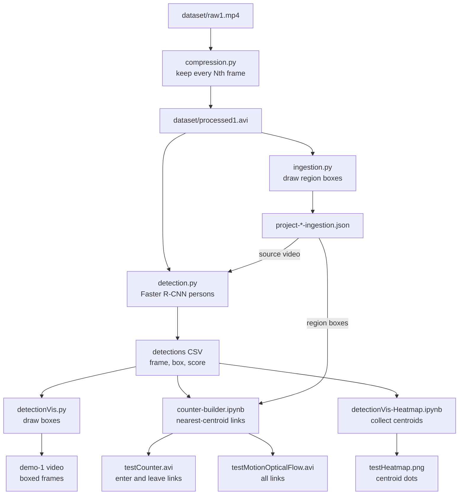

# Public Space Tracking

**English** · [简体中文](README.zh-CN.md)

**Detect people in street video, link their centroids across frames and mark moves into or out of chosen regions.**

<!-- problem-framing:start -->

## Problem and evidence

> **Can the detection-and-tracking pipeline count entrances and exits reliably after frame subsampling, compared with manual event annotations on held-out video?**

**Why it matters:** Counting errors can accumulate even when individual frames look convincing. A useful occupancy prototype needs event-level validation and explicit failure cases.

**Central tension:** Subsampling lowers processing cost but makes motion association harder; a simple centroid rule can confuse crossing people, occlusion and missed detections.

[Full problem and verification plan](PROBLEM.md) · [中文](PROBLEM.zh.md)

<!-- problem-framing:end -->

## Highlights

- **Detection:** people in each frame of the project video, using a Faster R-CNN Inception-ResNet v2 model from the TF2 Detection Zoo (COCO) loaded as a TensorFlow SavedModel. `Object_detection_T1.ipynb` and `Detectron2_T2.ipynb` are the stock TF-Hub and Detectron2 tutorials run on sample images, not a comparison on the project video.
- **Linking and labelling:** each box centroid is linked to the nearest centroid five frames later, and links longer than that frame's mean link length are dropped. A link that starts outside a rectangle drawn in `ingestion.py` and ends inside it is marked as entering (the reverse as leaving). No in/out totals are computed.
- **Outputs:** a video with detection boxes, a counter video showing the entering and leaving links, a video of all centroid links (`testMotionOpticalFlow.avi`) and an image with every detected centroid drawn as a dot.

## Architecture

Each step reads the file written by the step above it; `detectionVis.py`, `counter-builder.ipynb` and the heatmap notebook keep only detections scored above 0.8. The counter links each centroid to its nearest neighbour five frames later, keeps links shorter than that frame's mean distance, and marks a link that moves into or out of a region box.

## Pipeline

| Step | Script | What it does |
|---|---|---|
| Compress | `compression.py` | Keep the first N frames and every k-th frame (entered at a prompt, e.g. 5,000 and 5), resolution unchanged |
| Ingest | `ingestion.py` | Draw entrance and exit rectangles on a frame with the mouse and save them to JSON |
| Detect | `detection.py` | Run the pre-trained Faster R-CNN, keep the person class and save boxes to CSV |
| Visualize | `detectionVis.py` | Draw boxes on frames and rebuild the video |
| Link | `counter-builder.ipynb` | Link each centroid to the nearest one five frames later and mark links that enter or leave a rectangle |
| Heatmap | `detectionVis-Heatmap.ipynb` | Draw every detection centroid as a dot on one frame |

Detector weights go in `models/` (see the [TF2 detection zoo](https://github.com/tensorflow/models/blob/master/research/object_detection/g3doc/tf2_detection_zoo.md)).

Original notes

### Test

1. Object_detection_T1.ipynb
TensorFlow 

2. Detectron2_T2.ipynb
PyTorch

## Steps
### Compression
compression.py

compress + shorten videos (without changing the resloution)

For example, the raw video has 7000+ frames. For better testing, we choose first 5000 frames, and then we divide it by each 5 frames. 

So we can get a new video, in which people can still move smothly.

### Ingestion
ingestion.py

The project is about public space tracking, so we need the location of entrance and exit. This script can save information to json file.

### Detection
detection.py

With pre-trained model, we can detect people in processed videos, and save the bounding box data to csv file.

[tensorflow/models](https://github.com/tensorflow/models/blob/master/research/object_detection/g3doc/tf2_detection_zoo.md)
(download models and extract to models/ folder)

### Visilization
DetectionVis.py

Using csv file, we can draw the bounding boxs on each frame, and then combine them together, we can get a new video.

### Counter
counter-builder.ipynb

Continuity

By calculating the distance of nearest centeriods of each bounding box, we can know whether it is faster or slower than the mean distance. If it is slower, we can assume the centeriod is continued. If it can be contined by 5 frames, it will be someone's plotline. 
    I know this is not perfect regarding mean distance and continuity. They may be improved later :)

By calculating the location of plotline and boundingbox, we can know whether a person is entering or leaving the public area.

### Plot
detectionVis-Heatmap.ipynb

Draw the heatmaps based on bounding boxes. It needs linear transformation in the future to convert it to a top view picture.

