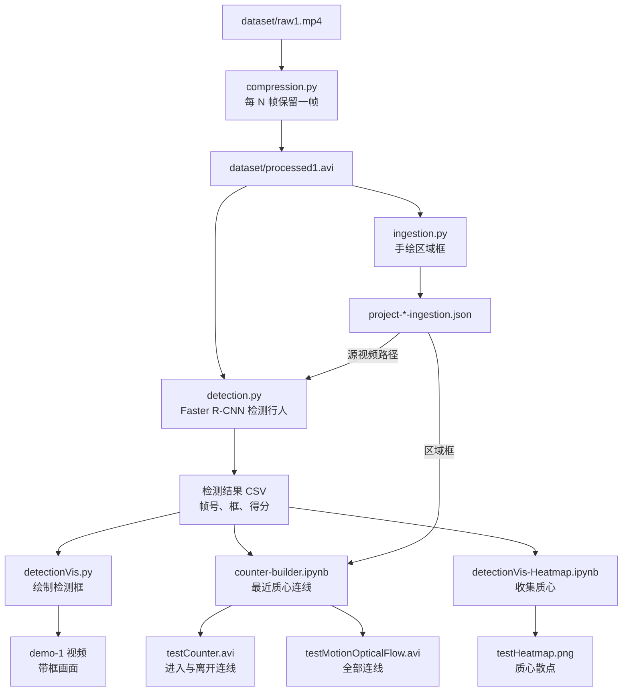

# Public Space Tracking

[English](README.md) · **简体中文**

**在街景视频中检测行人，跨帧连接质心，并标记进入或离开选定区域的移动。**

<!-- problem-framing:start -->

## 问题与依据

> **与留出视频上的人工事件标注相比，检测与跟踪流程在抽帧之后能否可靠地统计进出人数？**

**为什么值得解决：** 即使单帧结果看起来可信，计数误差仍会不断累积。一个有用的人数统计原型需要事件级验证，并明确列出失败案例。

**核心矛盾：** 抽帧降低了处理成本，却让运动关联更难；简单的质心规则可能把交错行走的人、遮挡和漏检混为一谈。

[完整问题与验证方案](PROBLEM.zh.md) · [English](PROBLEM.md)

<!-- problem-framing:end -->

## 亮点

- **检测：** 用 TF2 Detection Zoo 中的 Faster R-CNN Inception-ResNet v2 模型（COCO，以 TensorFlow SavedModel 加载）检测项目视频每一帧中的行人。`Object_detection_T1.ipynb` 和 `Detectron2_T2.ipynb` 是在示例图片上运行的 TF-Hub 与 Detectron2 官方教程，并不是在项目视频上的对比。
- **连线与标记：** 把每个检测框质心与五帧之后距离最近的质心相连，长于该帧平均连线长度的连线会被丢弃。若连线从 `ingestion.py` 手绘的矩形外开始、在矩形内结束，就标记为进入（反之为离开）。代码不计算进出总数。
- **输出：** 带检测框的视频、标出进入与离开连线的计数视频、包含全部质心连线的视频（`testMotionOpticalFlow.avi`），以及一张把所有检测质心画成散点的图片。

## 架构

每一步读取上一步写出的文件；`detectionVis.py`、`counter-builder.ipynb` 和热力图 notebook 只保留得分高于 0.8 的检测结果。计数器把每个质心与五帧之后距离最近的质心相连，只保留短于该帧平均距离的连线，并标出进入或离开区域框的连线。

## 流程

| 步骤 | 脚本 | 作用 |
|---|---|---|
| 压缩 | `compression.py` | 保留前 N 帧，每 k 帧取 1 帧（运行时输入，例如 5,000 和 5），分辨率不变 |
| 录入 | `ingestion.py` | 用鼠标在一帧画面上绘制入口和出口矩形，并保存为 JSON |
| 检测 | `detection.py` | 运行预训练的 Faster R-CNN，只保留 person 类，把检测框保存为 CSV |
| 可视化 | `detectionVis.py` | 在每帧上绘制检测框，再重新合成视频 |
| 连线 | `counter-builder.ipynb` | 把每个质心与五帧之后最近的质心相连，并标出进入或离开矩形的连线 |
| 热力图 | `detectionVis-Heatmap.ipynb` | 把所有检测质心画成散点，叠加在一帧画面上 |

检测器权重放在 `models/` 目录下（见 [TF2 detection zoo](https://github.com/tensorflow/models/blob/master/research/object_detection/g3doc/tf2_detection_zoo.md)）。

原始笔记（英文）

### Test

1. Object_detection_T1.ipynb
TensorFlow 

2. Detectron2_T2.ipynb
PyTorch

## Steps
### Compression
compression.py

compress + shorten videos (without changing the resloution)

For example, the raw video has 7000+ frames. For better testing, we choose first 5000 frames, and then we divide it by each 5 frames. 

So we can get a new video, in which people can still move smothly.

### Ingestion
ingestion.py

The project is about public space tracking, so we need the location of entrance and exit. This script can save information to json file.

### Detection
detection.py

With pre-trained model, we can detect people in processed videos, and save the bounding box data to csv file.

[tensorflow/models](https://github.com/tensorflow/models/blob/master/research/object_detection/g3doc/tf2_detection_zoo.md)
(download models and extract to models/ folder)

### Visilization
DetectionVis.py

Using csv file, we can draw the bounding boxs on each frame, and then combine them together, we can get a new video.

### Counter
counter-builder.ipynb

Continuity

By calculating the distance of nearest centeriods of each bounding box, we can know whether it is faster or slower than the mean distance. If it is slower, we can assume the centeriod is continued. If it can be contined by 5 frames, it will be someone's plotline. 
    I know this is not perfect regarding mean distance and continuity. They may be improved later :)

By calculating the location of plotline and boundingbox, we can know whether a person is entering or leaving the public area.

### Plot
detectionVis-Heatmap.ipynb

Draw the heatmaps based on bounding boxes. It needs linear transformation in the future to convert it to a top view picture.

